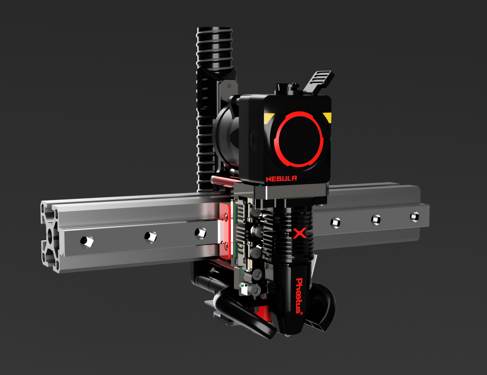
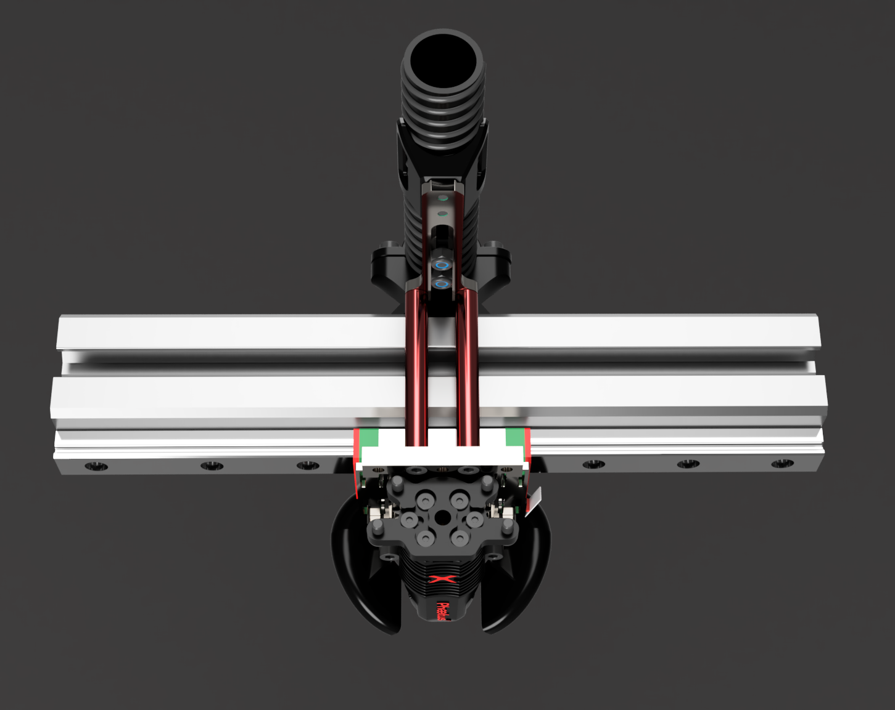
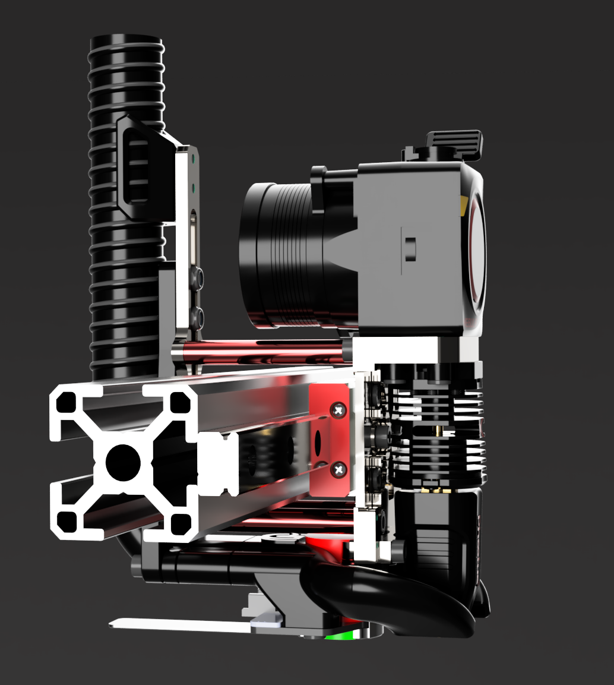

# mammoth-3D - CNC behemoth Toolhead for 3030 Aluminium Profile 3D Printers

## behemoth Toolhead for Elegoo Giga.

### All mammoth-3D / behemoth projects are licensed as

https://creativecommons.org/licenses/by-nc/4.0/