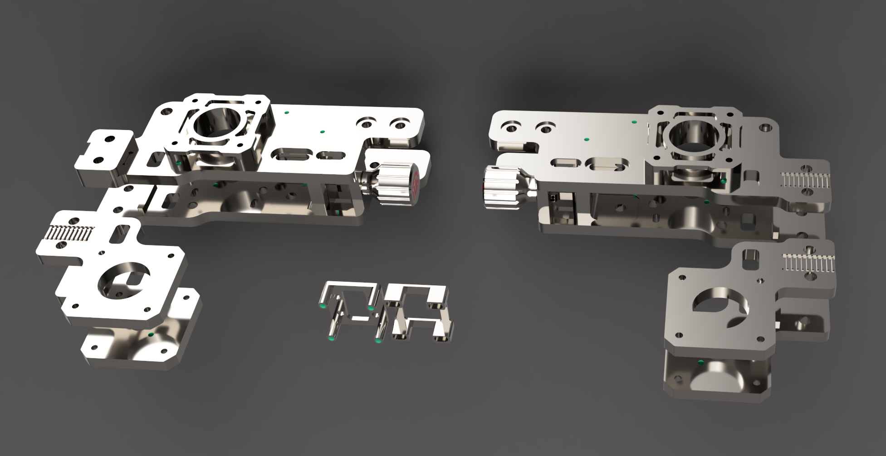

# mammoth-3D Aluminium CNC Gantry
This repository contains the CAD files for the **Mammoth-3D Aluminium (CNC) Gantry**, made available to the community for personal CNC machining and manufacturing.

## About This Release
As Mellow is no longer permitted to sell the mammoth-3D gantry, I have decided to make the CAD files publicly available on GitHub.

This allows community members to CNC-machine the gantry themselves or have the parts manufactured by a third-party CNC service.

## CAD Updates & Belt Clearance
Before publishing the files, I reviewed the CAD model and double-checked the belt routing, particularly the clearance between the belts and the aluminium profiles.

Although the original design already provided sufficient clearance, I decided to move the belts back by an additional **1 mm** to further reduce the risk of rubbing against the profiles.

## ⚠️ Important Installation Notes
When assembling the gantry, please pay special attention to the following:

- **Belt Clearance:** Ensure that the belts move freely without rubbing against the aluminium profiles.
- **Back Panel Installation:** After installing the back panel, carefully check that it does not come into contact with the belts.
- **Final Inspection:** Before operating the printer, verify that the entire belt path is free from interference.

**Please note:** Proper belt clearance is essential for smooth operation and to prevent premature belt wear.

## Disclaimer
These files are provided as-is for community use. Manufacturing, assembly, and installation are carried out at your own risk.

Please inspect all manufactured parts and verify mechanical clearances before operating your printer.

## Credits
Thank you to everyone supporting the mammoth-3D project and contributing to the community!

### All mammoth-3D / behemoth projects are licensed as

https://creativecommons.org/licenses/by-nc/4.0/